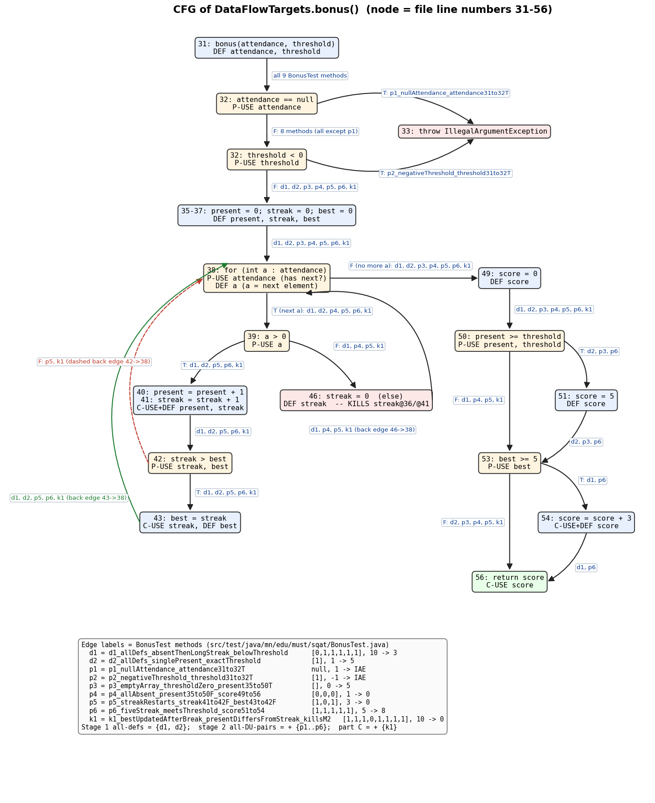

# Лаб 10 — Өгөгдлийн урсгалын тест (Definition-Use хосууд)

F.CSA313 — Программ хангамжийн чанарын баталгаа ба тест (2026)

- **Нэр:** Э.Батхүлэг
- **Оюутны код:** B232270040

### `java -version`

```
java version "23.0.2" 2025-01-21
Java(TM) SE Runtime Environment (build 23.0.2+7-58)
Java HotSpot(TM) 64-Bit Server VM (build 23.0.2+7-58, mixed mode, sharing)
```

### `mvn -version`

```
Apache Maven 3.9.16 (2bdd9fddda4b155ebf8000e807eb73fd829a51d5)
Maven home: D:\apache-maven-3.9.16-bin\apache-maven-3.9.16
Java version: 23.0.2, vendor: Oracle Corporation, runtime: D:\java
Default locale: en_US, platform encoding: UTF-8
OS name: "windows 11", version: "10.0", arch: "amd64", family: "windows"
```

Орчин: Windows 11 + Git Bash (`tee` нь UTF-8 бичдэг тул results/ дахь бүх файл UTF-8/ASCII текст).
`pom.xml`-д `maven.compiler.release=17` тул JDK 23 дээр Java 17 bytecode үүснэ.

Бүх мөрийн дугаар нь `src/main/java/mn/edu/must/sqat/DataFlowTargets.java` ФАЙЛЫН мөр.

---

## Хэсэг A — `gcd(x, y)` (мөр 13–20)

```java
13  public static int gcd(int x, int y) {   // def x, y
14      int tmp;                            // (зарлалт, def биш)
15      while (y != 0) {                    // p-use y
16          tmp = x % y;                    // def tmp; c-use x, y
17          x = y;                          // def x;   c-use y
18          y = tmp;                        // def y;   c-use tmp
19      }
20      return x;                           // c-use x
```

Def: x@13, x@17, y@13, y@18, tmp@16. Use: y — 15(p), 16(c), 17(c); x — 16(c), 20(c); tmp — 18(c).

### gcd-ийн бүрэн DU хүснэгт (13 хос)

| # | Хувьсагч | Def мөр | Use мөр | c/p-use | Def-clear зам | Тестийн ID | Хамрагдсан |
|---|---|---|---|---|---|---|---|
| 1 | x | 13 | 16 | c | 13→15(T)→16 | G2, G3, G4 | ✅ |
| 2 | x | 13 | 20 | c | 13→15(F)→20 | **G1** | ✅ |
| 3 | x | 17 | 16 | c | 17→18→15(T)→16 (≥2 давталт) | G3, G4 | ✅ |
| 4 | x | 17 | 20 | c | 17→18→15(F)→20 | G2, G3, G4 | ✅ |
| 5 | y | 13 | 15 (T) | p | 13→15(T) | G2, G3, G4 | ✅ |
| 6 | y | 13 | 15 (F) | p | 13→15(F) | **G1** | ✅ |
| 7 | y | 13 | 16 | c | 13→15(T)→16 | G2, G3, G4 | ✅ |
| 8 | y | 13 | 17 | c | 13→15(T)→16→17 | G2, G3, G4 | ✅ |
| 9 | y | 18 | 15 (T) | p | 18→15(T) (≥2 давталт) | G3, G4 | ✅ |
| 10 | y | 18 | 15 (F) | p | 18→15(F) | G2, G3, G4 | ✅ |
| 11 | y | 18 | 16 | c | 18→15(T)→16 (≥2 давталт) | G3, G4 | ✅ |
| 12 | y | 18 | 17 | c | 18→15(T)→16→17 (≥2 давталт) | G3, G4 | ✅ |
| 13 | tmp | 16 | 18 | c | 16→17→18 | G2, G3, G4 | ✅ |

Лекцид дутуу үлдсэн хосууд: **x(17→16)** (дараагийн давталтад x-ийн шинэ утга хэрэглэгдэх), **y(18→16)**, **y(18→17)** —
эдгээр нь давталтаар дамждаг (loop-carried) хосууд; мөн **x(13→20)**, **y(13→15F)** — давталтад огт орохгүй зам.
Биелэшгүй хос gcd-д байхгүй (13/13 хамрагдсан).

### GcdTest.java тестүүд

| ID | Метод | Оролт → гаралт | Давталт | Хамарсан хосууд |
|---|---|---|---|---|
| G1 | `g1_zeroIterations_x13to20_y13to15F` | gcd(7,0) → 7 | 0 | x(13→20), y(13→15F) |
| G2 | `g2_oneIteration_firstPassPairs` | gcd(0,5) → 5 | 1 | x(13→16), x(17→20), y(13→15T/16/17), y(18→15F), tmp(16→18) |
| G3 | `g3_twoIterations_loopCarriedPairs` | gcd(12,8) → 4 | 2 | G2-ийн хосууд + x(17→16), y(18→15T), y(18→16), y(18→17) |
| G4 | `g4_swappedArguments_threeIterations` | gcd(8,12) → 4 | 3 | G3-тай ижил хосууд (x<y үед эхний давталт x,y-г сольдог) |

**Заавар хариулт.**
- `gcd(7,0)` давталтад огт орохгүй (13→15F→20) тул **x(13→20)** ба **y(13→15F)** хоёр хосыг ГАНЦААРАА хамардаг — y=0-ээр эхэлсэн тест л эдгээрийг өгнө.
- `gcd(12,8)` **2 давталт** хийнэ: (x,y) = (12,8) → (8,4) → (4,0). Давталт (≥2 удаа биеийг гүйцэтгэх) шаарддаг хосууд нь 18 эсвэл 17-р мөрийн def-ийг дахин 15/16/17-д хүргэх хосууд: **x(17→16), y(18→15T), y(18→16), y(18→17)**. Нэг давталттай `gcd(0,5)` эдгээрийг хамарч чадахгүй.

---

## Хэсэг B — `bonus(attendance, threshold)` (мөр 31–56)

### B1 — CFG



Зангилаа бүр файлын мөрийн дугаартай; ирмэг бүр дээр түүнийг дайрдаг `BonusTest`-ийн тестүүд (d1, d2, p1…p6, k1 — зургийн доод хэсэгт метод нэрийн бүтэн жагсаалт).
Мөр 32-ын `||` нь short-circuit тул хоёр шийдвэрийн зангилаа (32: `attendance == null`, 32: `threshold < 0`) болгон задалсан.
For-each (мөр 38): нөхцөл = attendance-д дараагийн элемент байгаа эсэх (attendance-ийн p-use), алхам = `a`-д дараагийн элемент оноох (a-ийн def).
Мөр 40 ба 41 нь салбаргүй дараалсан тул нэг зангилаанд нэгтгэсэн.
Зургийг Python matplotlib-ээр зурсан.

### B2 — Def/Use жагсаалт (мөр бүрээр)

```java
31  bonus(int[] attendance, int threshold)  // DEF attendance, threshold
32  if (attendance == null || threshold < 0) // P-USE attendance; P-USE threshold (зөвхөн attendance != null үед)
33      throw new IllegalArgumentException   // (use байхгүй)
35  int present = 0;                        // DEF present
36  int streak = 0;                         // DEF streak
37  int best = 0;                           // DEF best
38  for (int a : attendance)                // P-USE attendance (дараагийн элемент байгаа юу?); DEF a
39      if (a > 0)                          // P-USE a
40          present = present + 1;          // C-USE present; DEF present
41          streak = streak + 1;            // C-USE streak;  DEF streak
42          if (streak > best)              // P-USE streak, best
43              best = streak;              // C-USE streak;  DEF best
46      else streak = 0;                    // DEF streak  (KILL: streak@36, streak@41)
49  int score = 0;                          // DEF score
50  if (present >= threshold)               // P-USE present, threshold
51      score = 5;                          // DEF score   (KILL: score@49)
53  if (best >= 5)                          // P-USE best
54      score = score + 3;                  // C-USE score; DEF score
56  return score;                           // C-USE score
```

### B3 — DU хүснэгт (def-clear замтай бүх хос; p-use-ийг T/F салаагаар)

Тестүүд: D1 = `d1_allDefs_absentThenLongStreak_belowThreshold` ([0,1,1,1,1,1], 10 → 3),
D2 = `d2_allDefs_singlePresent_exactThreshold` ([1], 1 → 5),
P1 = `p1_nullAttendance_attendance31to32T` (null, 1 → IAE),
P2 = `p2_negativeThreshold_threshold31to32T` ([1], −1 → IAE),
P3 = `p3_emptyArray_thresholdZero_present35to50T` ([], 0 → 5),
P4 = `p4_allAbsent_present35to50F_score49to56` ([0,0,0], 1 → 0),
P5 = `p5_streakRestarts_streak41to42F_best43to42F` ([1,0,1], 3 → 0),
P6 = `p6_fiveStreak_meetsThreshold_score51to54` ([1,1,1,1,1], 5 → 8).

| # | Хувьсагч | Def | Use | c/p | Def-clear зам (жишээ) | Тестийн ID | Хамрагдсан |
|---|---|---|---|---|---|---|---|
| 1 | attendance | 31 | 32 (T: ==null) | p | 31→32 | P1 | ✅ |
| 2 | attendance | 31 | 32 (F) | p | 31→32 | D1, D2, P2–P6 | ✅ |
| 3 | attendance | 31 | 38 (T: элемент бий) | p | 31→32F→32F→35–37→38 | D1, D2, P4–P6 | ✅ |
| 4 | attendance | 31 | 38 (F: дууссан) | p | 31→…→38 (attendance дахин def хийгддэггүй) | P3 (0 давталт), D1, D2 | ✅ |
| 5 | threshold | 31 | 32 (T: <0) | p | 31→32(attendance≠null)→32 | P2 | ✅ |
| 6 | threshold | 31 | 32 (F) | p | 31→32→32 | D1, D2, P3–P6 | ✅ |
| 7 | threshold | 31 | 50 (T) | p | 31→…→49→50 | D2, P3, P6 | ✅ |
| 8 | threshold | 31 | 50 (F) | p | 31→…→49→50 | D1, P4, P5 | ✅ |
| 9 | present | 35 | 40 | c | 35→38→39T→40 (эхний ирсэн өдөр) | D1, D2, P5, P6 | ✅ |
| 10 | present | 35 | 50 (T) | p | 35→38F→49→50 (ирсэн өдөргүй, threshold=0) | P3 | ✅ |
| 11 | present | 35 | 50 (F) | p | 35→38→39F→46→38F→49→50 | P4 | ✅ |
| 12 | present | 40 | 40 | c | 40→41→42→(43)→38→39T→40 (46-аар дамжсан ч present def-clear) | D1, P5, P6 | ✅ |
| 13 | present | 40 | 50 (T) | p | 40→…→38F→49→50 | D2, P6 | ✅ |
| 14 | present | 40 | 50 (F) | p | 40→…→38F→49→50 | D1, P5 | ✅ |
| 15 | streak | 36 | 41 | c | 36→38→39T→40→41 (эхний элемент ирсэн) | D2, P5, P6 | ✅ |
| 16 | streak | 41 | 41 | c | 41→42→(43)→38→39T→40→41 (дараалсан ирц) | D1, P6 | ✅ |
| 17 | streak | 41 | 42 (T) | p | 41→42 | D1, D2, P5, P6 | ✅ |
| 18 | streak | 41 | 42 (F) | p | 41→42 (тасарсны дараах цуваа ≤ best) | P5 | ✅ |
| 19 | streak | 41 | 43 | c | 41→42T→43 | D1, D2, P5, P6 | ✅ |
| 20 | streak | 46 | 41 | c | 46→38→39T→40→41 (тасалсны дараа ирсэн) | D1, P5 | ✅ |
| 21 | best | 37 | 42 (T) | p | 37→38→39T→40→41→42 | D1, D2, P5, P6 | ✅ |
| 22 | best | 37 | 42 (F) | p | — | — | ❌ **биелэшгүй** |
| 23 | best | 37 | 53 (T) | p | — | — | ❌ **биелэшгүй** |
| 24 | best | 37 | 53 (F) | p | 37→38(→39F→46)*→38F→49→50→53 (ирсэн өдөргүй) | P3, P4 | ✅ |
| 25 | best | 43 | 42 (T) | p | 43→38→39T→40→41→42 | D1, P6 | ✅ |
| 26 | best | 43 | 42 (F) | p | 43→38→39F→46→38→39T→40→41→42 | P5 | ✅ |
| 27 | best | 43 | 53 (T) | p | 43→38F→49→…→53 (best ≥ 5) | D1, P6 | ✅ |
| 28 | best | 43 | 53 (F) | p | 43→…→53 (1 ≤ best ≤ 4) | D2, P5 | ✅ |
| 29 | a | 38 | 39 (T) | p | 38→39 | D1, D2, P5, P6 | ✅ |
| 30 | a | 38 | 39 (F) | p | 38→39 | D1, P4, P5 | ✅ |
| 31 | score | 49 | 54 | c | 49→50F→53T→54 | D1 | ✅ |
| 32 | score | 49 | 56 | c | 49→50F→53F→56 | P4, P5 | ✅ |
| 33 | score | 51 | 54 | c | 51→53T→54 | P6 | ✅ |
| 34 | score | 51 | 56 | c | 51→53F→56 | D2, P3 | ✅ |
| 35 | score | 54 | 56 | c | 54→56 | D1, P6 | ✅ |

**Нийт 35 хос: 33 биелэх — бүгд хамрагдсан (33/33), 2 биелэшгүй.**
Хэсэг C-д нэмсэн K1 тест (#16, #18, #20, #25–28 гэх мэт) хосуудыг дахин хамардаг ч шинэ хос нэмээгүй.

**Биелэшгүй хосын үндэслэл:**
- **#22 best(37→42F):** 42-т анх хүрэхэд best=0 (37-оос), streak ≥ 1 (41 дөнгөж нэмэгдсэн) тул `streak > best` ҮРГЭЛЖ үнэн — 37-ийн def-ийг F салаагаар хэрэглэх боломжгүй; T салаа 43-ыг гүйцэтгэж best-ийг шууд дахин def хийдэг.
- **#23 best(37→53T):** 37-ийн def 53-т def-clear хүрэх цорын ганц арга нь давталтад нэг ч ирсэн өдөр байхгүй (43 гүйцэтгэгдээгүй) байх; тэгвэл best=0 тул `0 >= 5` үргэлж худал.

**Мөр 46 (`streak = 0`) аль def-үүдийг АЛДАГ (kill):** streak@36 ба streak@41.
- 36→39F→46: эхний элемент 0 бол streak@36 ямар ч use-д хүрэхгүйгээр алагдана (P4-т streak@36 огт хэрэглэгдэхгүй). Гэхдээ #15 хос өөр зам (эхний элемент ирсэн) -аар def-clear тул DU хос хэвээр.
- 41→42→38→39F→46: тасалсан өдөр streak@41-ийг алж, дараагийн 41 нь streak@46-г хэрэглэнэ (#20). #16 зөвхөн 46-гүй (дараалсан) замаар def-clear.
- Мөр 51 нь score@49-ийг алдаг: 50T үед 49-ийн def ямар ч use-д хүрэхгүй (#31, #32 зөвхөн 50F замаар).

**Kill-ээр тасардаг тул DU хос гэж ТООЦООГҮЙ хослолууд (def-clear зам байхгүй):**
- streak(36→42), streak(36→43) — 42/43-т хүрэх бүх зам 41-ээр дамжиж streak-ийг дахин def хийнэ.
- streak(46→42), streak(46→43) — мөн 41-ээр алагдана (46-аас 42 руу 40→41-гүй зам байхгүй).
- streak(41→41)-ийн 46-аар дамжсан зам, streak(36→41)-ийн 46-аар дамжсан зам — 46 алдаг (хос нь өөр замаар л тоологдсон).
- score(49→54/56)-ийн 51-ээр дамжсан зам — 51 алдаг.

### B4 — Хоёр шатны тестүүд

**Шат 1 — ALL-DEFS: 2 тест (D1, D2).** Def бүр (attendance, threshold @31; present @35, @40; streak @36, @41, @46; best @37, @43; a @38; score @49, @51, @54) дор хаяж нэг use-д хүрнэ:

| Def | D1 [0,1,1,1,1,1], 10 | D2 [1], 1 |
|---|---|---|
| attendance@31, threshold@31 | →32, 38, 50 | →32, 38, 50 |
| present@35 / @40 | 35→40, 40→40, 40→50 | 35→40, 40→50 |
| streak@36 | (46 алдана) | **36→41** |
| streak@41 / @46 | 41→41/42/43, **46→41** | 41→42/43 |
| best@37 / @43 | 37→42, 43→42, 43→53 | 37→42, 43→53 |
| a@38 | 38→39 T/F | 38→39 T |
| score@49 | **49→54** (50F) | (51 алдана) |
| score@51 | — | **51→56** (50T) |
| score@54 | **54→56** | — |

**Яагаад 1 тест хүрэлцэхгүй вэ:** score@49 нь зөвхөн мөр 50 **F** үед use-д (54 эсвэл 56) хүрнэ — 50T бол 51 түүнийг шууд алдаг.
Харин score@51 нь зөвхөн мөр 50 **T** үед л үүснэ. Нэг гүйцэтгэлд 50 нэг л удаа, нэг л салаагаар явдаг тул score@49 ба score@51 хоёрыг нэг тестээр use-д хүргэх боломжгүй → **хамгийн цөөндөө 2 тест**.
(Мөн streak@36 нь эхний элемент ирсэн, streak@46 нь дор хаяж нэг тасалсан өдрийн дараа ирсэн өдөр шаарддаг — D2 ба D1 ингэж хуваасан.)

**Шат 2 — ALL-DU-PAIRS:** P1–P6 (6 тест) нэмж, D1/D2-ын хамраагүй хосуудыг хамарсан: #1 (P1), #5 (P2), #10 ба #4-ийн 0 давталт (P3), #11, #24, #32 (P4), #18, #26 (P5), #33 (P6). BonusTest = 8 тест.

### B5 — JaCoCo (`results/jacoco-*.csv`, класс `DataFlowTargets`)

| Үе шат | Tests run (gcd 4 + bonus) | BRANCH missed/covered | LINE missed/covered |
|---|---|---|---|
| all-defs (`results/jacoco-alldefs.csv`, `results/mvn-verify-alldefs.txt`) | **6** (4 + 2) | **3 / 13** (13/16) | 2 / 22 |
| эцсийн (`results/jacoco-final.csv`, `results/mvn-verify-final.txt`) | **13** (4 + 9) | **0 / 16** (16/16) | **1 / 23** |

Эцсийн LINE_MISSED = 1 нь 7-р мөрийн далд constructor `DataFlowTargets()` (тест бичих шаардлагагүй).
all-defs үед LINE_MISSED = 2 нь 7-р мөр + 33-р мөр (`throw`).

**all-defs хангагдсан ч branch 100% биш байж болох уу? — Тийм.** all-defs үед Branch 13/16 байсан. Дутуу 3 салаа:
32 `attendance == null` T, 32 `threshold < 0` T (def нь хэрэглэгдэх л хангалттай — exception замыг шаарддаггүй), 42 F (best@43-ийг 42-т хүргэхэд T салаа хангалттай).

**Branch 100% болсон ч DU хос хамрагдаагүй үлдэж болох уу? — Тийм.** Жишээ:
- gcd-д зөвхөн `gcd(12,8)` тест: 15-ын T ба F хоёулаа явагдаж gcd-ийн branch 2/2 (100%), гэхдээ **x(13→20)** ба **y(13→15F)** хамрагдахгүй — тэдгээрийг зөвхөн `gcd(7,0)` шиг давталтгүй зам өгнө.
- bonus-д эцсийн тестээс P3-ыг хасахад branch 16/16 хэвээр (50T-г D2, 38F-г бусад тест өгнө), гэхдээ **present(35→50T)** хос хамрагдахгүй: ирсэн өдөргүй + threshold=0 гэсэн тохиолдол branch-аас харагддаггүй.
- Мөн Хэсэг C-ийн M2: бүх DU хос хамрагдсан ч алдаа баригдаагүй — хамралт ≠ алдаа илрүүлэх баталгаа.

---

## Хэсэг C — Fault seeding

Мутаци бүрийг `DataFlowTargets.java` дээр шууд хийж, `mvn test 2>&1 | tee results/mvn-test-Mx.txt` ажиллуулаад эх файлыг буцаасан (буцаасны дараа эх хувьтай `cmp`-ээр байт-байтаар ижил гэж шалгасан). Мутаци commit хийгдээгүй.
Мутаци хийх үед BonusTest нь all-DU-pairs шатны 8 тест (D1, D2, P1–P6) байсан → Tests run 12 (gcd 4 + bonus 8).

| № | Мутаци | Төрөл | Tests run | Унасан тест | expected / was (файлаас) | Үр дүн |
|---|---|---|---|---|---|---|
| M1 | мөр 41 `streak = streak + 1;` устгах | Missing update | 12, Failures: 2 | `BonusTest.d1_allDefs_absentThenLongStreak_belowThreshold:24`<br>`BonusTest.p6_fiveStreak_meetsThreshold_score51to54:68` | `expected: <3> but was: <0>`<br>`expected: <8> but was: <5>` | **Алагдсан** |
| M2 | мөр 43 `best = streak;` → `best = present;` | Wrong variable | 12, Failures: 0 | — | — | **АМЬД** |
| M3 | мөр 48-ын дараа `int total = present + best;` | Dead definition | 12, Failures: 0 | — | — | **АМЬД** (хүлээгдэж буй) |
| M2 + K1 | M2 хэвээр, K1 тест нэмсэн (`results/mvn-test-M2-kill.txt`) | — | 13, Failures: 1 | `BonusTest.k1_bestUpdatedAfterBreak_presentDiffersFromStreak_killsM2:76` | `expected: <0> but was: <3>` | **Алагдсан** |

**M1:** streak үргэлж 0 → `streak > best` хэзээ ч үнэн биш → best=0 → +3 урамшуулал хэзээ ч өгөгдөхгүй. streak(41→41), (41→42), (41→43) хосуудыг хамардаг, best ≥ 5 шаарддаг тестүүд (D1, P6) барьсан.

**M2 яагаад all-DU-pairs-ийг давж амьд үлдсэн бэ?** M2-д `if (streak > best)` нөхцөл хэвээр, зөвхөн 43-т хэрэглэгдэх хувьсагч өөрчлөгдсөн. best шинэчлэгдэх мөч бүрд манай тестүүдэд **present == streak** байсан:
D1 [0,1,1,1,1,1]-д тасалсан өдөр цувааны ӨМНӨ байгаа тул ирсэн өдөр бүрт present = streak (1,2,3,4,5);
P5 [1,0,1]-д тасарсны дараа 42 F болж best шинэчлэгддэггүй; D2, P6-д тасалдал огт алга.
DU хамралт нь «хос дор хаяж нэг удаа гүйцэтгэгдсэн» гэдгийг л шаарддаг — гүйцэтгэх мөчид буруу хувьсагч зөв хувьсагчтай ИЖИЛ утгатай бол үр дүн өөрчлөгдөхгүй (coincidental correctness).
**Унагах тест K1** `[1,1,1,0,1,1,1,1]`, threshold=10: тасарсны дараах 4 дэх өдөр streak=4 > best=3 үед best шинэчлэгдэнэ; тэр мөчид present=7, streak=4.
Эх код: best=4 → +3 байхгүй, present=7 < 10 → **0**. M2: best=7 ≥ 5 → **3**. (Хэрэв M2-ийг `if`-ийг бүхэлд нь `best = present;` гэж солих байдлаар ойлговол best=7 болж мөн 3 буцаана — K1 хоёр хувилбарыг хоёуланг нь барина.)

**M3 яагаад ямар ч тест унагадаггүй вэ?** `total` тодорхойлогдоод хэзээ ч хэрэглэгдэхгүй (def-гүй use биш, харин **use-гүй def**, DU хос үүсгэдэггүй) — `score`-ийн утга, гаралт огт өөрчлөгддөггүй тул ямар ч динамик тест (гаралт шалгадаг) үүнийг барих боломжгүй. javac ч анхааруулдаггүй (`-Xlint:all`-д ашиглагдаагүй локал хувьсагчийн анхааруулга байхгүй).
Үүнийг барих ёстой багаж нь **статик анализ** (data-flow anomaly "defined-not-used", dd/du гажилт). M3 идэвхтэй байхад VS Code-ийн Java өргөтгөл (Eclipse JDT) дараах анхааруулгыг Problems самбарт гаргасан:

```
DataFlowTargets.java:49  Warning (Java 536870973): The value of the local variable total is not used
```

Ижил төрлийн дүрмүүд: PMD `UnusedLocalVariable`, SpotBugs `DLS_DEAD_LOCAL_STORE`, SonarLint (unused local variable).

Эцэст нь `src/main` нь starter-тэй ижил (`git diff <Starter commit> HEAD -- src/main` хоосон), эцсийн `mvn verify` ногоон: Tests run 13, Failures 0.

---

## Дүгнэлт

DU анализ нь branch хамралтаас илүү, учир нь салаа бүрийг биш, утга **хаана үүсч хаана хэрэглэгдэж буй** холбоосыг шалгадаг: gcd(7,0)-ийн x(13→20), bonus-ийн present(35→50T) зэрэг branch 100% үед ч алгасагддаг замыг илрүүлсэн.
Мөн давталтаар дамжих (loop-carried) хосууд нь давталтыг 2+ удаа гүйлгэх шаардлагыг автоматаар гаргаж ирдэг.
Гэхдээ үнэтэй: JaCoCo DU хамралт хэмждэггүй тул CFG зурах, def/use жагсаах, kill-ийг замаар шалгах, биелэшгүй хосыг нотлох бүгд гар ажил бөгөөд алдаа гаргахад амархан.
all-defs нь branch 100%-ийг ч баталгаажуулдаггүй (13/16), харин all-DU-pairs ч алдаа барихыг баталгаажуулдаггүй — M2 бүх хос хамрагдсан атал амьд үлдсэн (утгууд санамсаргүй давхцсан), M3 огт динамикаар баригдахгүй.
Тиймээс DU тест, мутацийн тест ба статик анализыг хослуулах нь хамгийн үр дүнтэй.
Хамгийн их цаг авсан алхам нь B3 — bonus-ийн kill-ийг зам бүрээр шалгаж, биелэшгүй хосуудыг (best@37→42F, best@37→53T) нотлох байсан.


